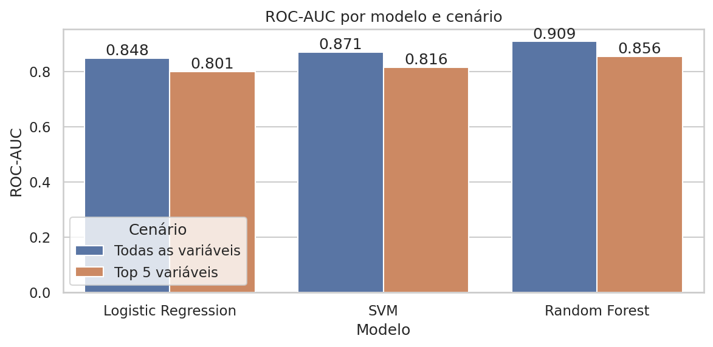
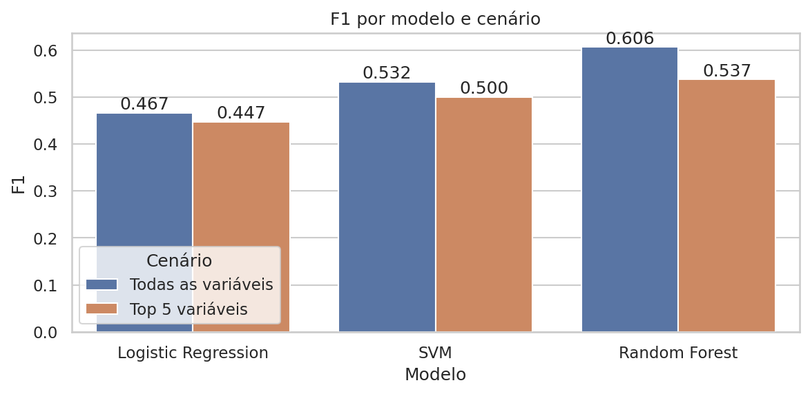
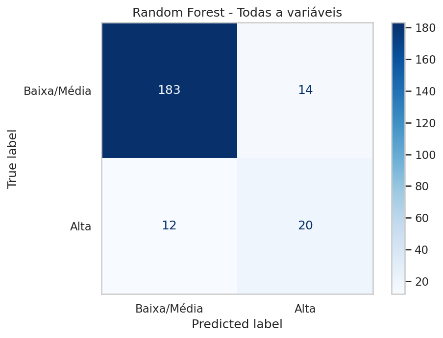
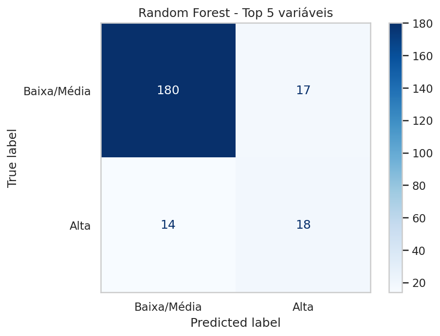

# TechChallenge_Fase2_WineQuality


## Wine Quality Classification

Classificação da qualidade de vinhos com Machine Learning, a partir de dados físico-químicos.
Projeto do **Tech Challenge – Fase 2**.

## Sumário

1. [Objetivo](#1-objetivo)
2. [Estrutura do repositório](#2-estrutura-do-repositório)
3. [Base de dados](#3-base-de-dados)
4. [Principais achados da análise exploratória](#4-principais-achados-da-análise-exploratória)
5. [Metodologia](#5-metodologia)
6. [Resultados](#6-resultados)
7. [Interpretação dos resultados](#7-interpretação-dos-resultados)
8. [Limitações](#8-limitações)
9. [Como executar](#9-como-executar)
10. [Entregáveis](#10-entregáveis)
11. [Tecnologias](#11-tecnologias)
12. [Autora](#12-autora)

## 1. Objetivo

Desenvolver um modelo de classificação capaz de identificar padrões nos dados físico-químicos de vinhos e prever se um vinho pertence ou não ao grupo de **alta qualidade**, contribuindo para uma avaliação mais rápida, objetiva e baseada em dados.

A avaliação tradicional da qualidade é feita por especialistas, por análise sensorial, o que pode ser subjetivo e demorado. Modelos preditivos podem apoiar enólogos e produtores na tomada de decisão e na padronização da qualidade.

## 2. Estrutura do repositório

```
wine-quality-classification/
│
├── data/                # Base de dados utilizada
├── notebooks/           # Notebook com a análise e modelagem
├── src/                 # Scripts auxiliares (pré-processamento ou modelagem)
├── results/             # Gráficos e métricas dos modelos
├── requirements.txt     # Bibliotecas utilizadas
└── README.md            # Descrição do projeto
```

| Item | Conteúdo |
|---|---|
| `data/` | `WineQT.csv`, base Wine Quality Dataset (Kaggle), sem alterações. |
| `notebooks/` | `Tech_Challenge_Fase2_CristianeLimaSantos.ipynb`: compreensão do problema, pré-processamento, análise exploratória, modelagem, avaliação e interpretação. |
| `src/` | `preprocessing.py` (target, seleção das variáveis, divisão, normalização e SMOTE), `modeling.py` (modelos, ROC-AUC e F1) e `evaluation.py` (matrizes de confusão e métricas). Reproduzem as etapas do notebook. |
| `results/` | `metricas_modelos.csv`, matrizes de confusão (`cm_<modelo>_<cenário>.png`) e gráficos de barras das métricas (`barras_ROC-AUC.png` e `barras_F1.png`). |
| `requirements.txt` | Bibliotecas necessárias para executar o notebook. |
| `README.md` | Este documento. |

A apresentação executiva (PDF), com o storytelling da análise exploratória, fica armazenada no repositório; veja a seção [Entregáveis](#10-entregáveis).

## 3. Base de dados

- **Fonte:** Wine Quality Dataset (Kaggle), arquivo `WineQT.csv`.
- **Tamanho:** 1.143 amostras, 11 variáveis físico-químicas e a nota de qualidade atribuída por especialistas (`quality`). A coluna `Id` é removida no pré-processamento.
- **Variáveis:** acidez fixa (`fixed acidity`), acidez volátil (`volatile acidity`), ácido cítrico (`citric acid`), açúcar residual (`residual sugar`), cloretos (`chlorides`), dióxido de enxofre livre (`free sulfur dioxide`), dióxido de enxofre total (`total sulfur dioxide`), densidade (`density`), `pH`, sulfatos (`sulphates`) e teor alcoólico (`alcohol`).

### Variável target

A nota `quality` foi transformada em uma classificação binária (`quality_bin`):

| Classe | Critério | Quantidade | % |
|---|---|---|---|
| 1 – Alta qualidade | nota ≥ 7 | 159 | 14% |
| 0 – Baixa/média qualidade | nota < 7 | 984 | 86% |

A base é **fortemente desbalanceada**, o que orientou as escolhas de modelagem e de métricas.

## 4. Principais achados da análise exploratória

- **Valores ausentes:** nenhum.
- **Duplicatas:** 125 linhas duplicadas (10,9% da base; 239 linhas envolvidas), concentradas nas notas 5, 6 e 7. Foram identificadas e mantidas na base.
- **Zeros em `citric acid`:** 99 linhas (8,7%), concentradas na classe de baixa/média qualidade (95 linhas, contra 4 da classe de alta qualidade). Foram mantidas: não há indício de erro de registro, removê-las reduziria a classe minoritária e a exclusão praticamente não altera a correlação do ácido cítrico com a alta qualidade (de +0,25 para +0,24).
- **Outliers (método IQR):** maior proporção em `residual sugar` (9,6%) e `chlorides` (6,7%). Foram mantidos, por refletirem a variabilidade natural dos vinhos e não indicarem erros de coleta.
- **Distribuição das notas:** variam de 3 a 8, com mediana 6 e concentração nas notas 5 e 6.
- **Matriz de correlação (Pearson) com `quality_bin`:** `alcohol` (+0,40), `citric acid` (+0,25) e `sulphates` (+0,21) têm as maiores correlações positivas; `volatile acidity` (−0,30) e `density` (−0,15) têm as maiores correlações negativas. Pela classificação adotada (|r| de 0,3 a 0,5 fraca; abaixo de 0,3 sem correlação), apenas `alcohol` e `volatile acidity` atingem a faixa de correlação fraca; as demais variáveis não possuem correlação linear relevante com a alta qualidade.

## 5. Metodologia

1. **Pré-processamento:** remoção da coluna `Id` e criação da variável target `quality_bin`.
2. **Dois cenários de modelagem:**
   - **Full:** todas as 11 variáveis.
   - **Top 5:** as 5 variáveis com correlação positiva (Spearman) com `quality_bin`: `alcohol`, `sulphates`, `citric acid`, `fixed acidity` e `residual sugar`.
3. **Divisão treino/teste:** 80% / 20%, estratificada pela classe (`random_state=42`). O teste tem 229 vinhos, sendo 197 de baixa/média qualidade e 32 de alta qualidade.
4. **Normalização:** `StandardScaler` ajustado no treino e aplicado no teste.
5. **Balanceamento:** SMOTE aplicado **somente no treino** (`random_state=42`); o teste mantém a proporção original.
6. **Modelos** (todos com `class_weight='balanced'`):
   - Regressão Logística (`max_iter=500`)
   - SVM com kernel RBF
   - Random Forest (300 árvores, `random_state=42`)
7. **Métricas:** ROC-AUC e F1-Score da classe de alta qualidade (minoritária), além da matriz de confusão e da curva Precisão × Recall.

## 6. Resultados

### Métricas na base de teste

| Modelo | Cenário | ROC-AUC | F1 |
|---|---|---|---|
| Regressão Logística | Full | 0,848 | 0,467 |
| SVM | Full | 0,871 | 0,532 |
| **Random Forest** | **Full** | **0,909** | **0,606** |
| Regressão Logística | Top 5 | 0,801 | 0,447 |
| SVM | Top 5 | 0,816 | 0,500 |
| Random Forest | Top 5 | 0,856 | 0,537 |

O **Random Forest com todas as variáveis** teve o melhor desempenho. Com apenas as 5 variáveis, o mesmo modelo teve queda de cerca de 5,8% no ROC-AUC e de 11,4% no F1.

| ROC-AUC por modelo e cenário | F1 por modelo e cenário |
|---|---|
|  |  |

### Matrizes de confusão (base de teste: 197 baixa/média e 32 alta)

| Modelo | Cenário | Baixa/média acertos | Falsos "Alta" | Falsos "Baixa/média" | Alta acertos |
|---|---|---|---|---|---|
| Regressão Logística | Full | 160 | 37 | 11 | 21 |
| SVM | Full | 171 | 26 | 11 | 21 |
| Random Forest | Full | 183 | 14 | 12 | 20 |
| Regressão Logística | Top 5 | 156 | 41 | 11 | 21 |
| SVM | Top 5 | 166 | 31 | 11 | 21 |
| Random Forest | Top 5 | 180 | 17 | 14 | 18 |

Os três modelos identificam um número parecido de vinhos de alta qualidade (20 a 21 dos 32 do teste). A vantagem do Random Forest está na **precisão**: gera menos falsos positivos (14, contra 26 do SVM e 37 da Regressão Logística). No Random Forest Full, a precisão da classe "Alta" é 58,8% e o recall é 62,5%.

| Random Forest – Todas as variáveis | Random Forest – Top 5 variáveis |
|---|---|
|  |  |

### Curva Precisão × Recall

Como a classe de alta qualidade é minoritária (14% do teste), a curva Precisão × Recall complementa o ROC-AUC. A precisão média (AP) de cada modelo, indicada na legenda das curvas, foi:

| Modelo | Full | Top 5 |
|---|---|---|
| Regressão Logística | 0,54 | 0,40 |
| SVM | 0,65 | 0,41 |
| Random Forest | 0,71 | 0,57 |

Para comparação, um classificador aleatório teria AP próximo de 0,14.

## 7. Interpretação dos resultados

- **Teor alcoólico:** maior correlação positiva com a alta qualidade (+0,40, faixa fraca). Vinhos de alta qualidade têm mediana de 11,6 contra 10,0 nos demais.
- **Acidez volátil:** maior correlação negativa (−0,30, no limite da faixa fraca). Representa o ácido acético, que em excesso dá gosto de vinagre e indica deterioração.
- **Ácido cítrico e sulfatos:** as medianas são maiores nos vinhos de alta qualidade, mas a correlação (+0,25 e +0,21) fica abaixo da faixa fraca.
- **Demais variáveis:** sem correlação linear relevante com a alta qualidade.
- Nenhuma variável isolada explica a qualidade, e correlação não implica causalidade.

Sugestões para o processo de produção, a serem lidas como associações observadas nos dados: controlar a fermentação para atingir níveis adequados de álcool, monitorar os sulfatos, manter o equilíbrio da acidez (ácido cítrico e acidez fixa), ajustar o açúcar residual ao estilo do vinho e reduzir a acidez volátil.

## 8. Limitações

- A classe de alta qualidade tem apenas 32 vinhos no teste; diferenças de 1 ou 2 acertos entre modelos devem ser interpretadas com cautela.
- Os resultados vêm de **uma única divisão** treino/teste.
- A seleção do Top 5 foi feita com a base completa, antes da divisão treino/teste, e considera apenas variáveis com correlação **positiva**. Por isso `volatile acidity` e `chlorides`, com correlação negativa, não entram no cenário Top 5.
- As duplicatas foram mantidas, e uma mesma linha pode aparecer no treino e no teste.
- Mesmo o melhor modelo erra cerca de 4 em cada 10 previsões de alta qualidade (14 falsos positivos em 34 previsões "Alta"). Ele serve como apoio à triagem, e não substitui a avaliação de especialistas.

## 9. Como executar

```bash
git clone <url-do-repositorio>
cd TechChallenge_Fase2_WineQuality
pip install -r requirements.txt
jupyter notebook notebooks/Tech_Challenge_Fase2_CristianeLimaSantos.ipynb
```

Os caminhos do notebook são relativos à pasta em que ele é executado: ele lê `WineQT.csv` e grava os resultados em `results/`. Para executá-lo a partir de `notebooks/`, use `../data/WineQT.csv` na leitura da base e `../results` ao salvar os arquivos. No Google Colab, basta enviar o `WineQT.csv` para a pasta de trabalho.

## 10. Entregáveis

- **Repositório:** código, notebook, scripts auxiliares e resultados, na estrutura básica descrita na seção 2.
- **Apresentação executiva:** PDF com o storytelling da análise exploratória, armazenado no repositório (`docs/Apresentacao_Executiva_TechChallenge_Fase2.pdf`).
- **Vídeo executivo:** `<link-do-video](https://youtu.be/77Rc7zUgqbs>`

## 11. Tecnologias

Python, pandas, NumPy, matplotlib, seaborn, missingno, scikit-learn e imbalanced-learn (SMOTE).

## 12. Autora

Cristiane Lima Santos
